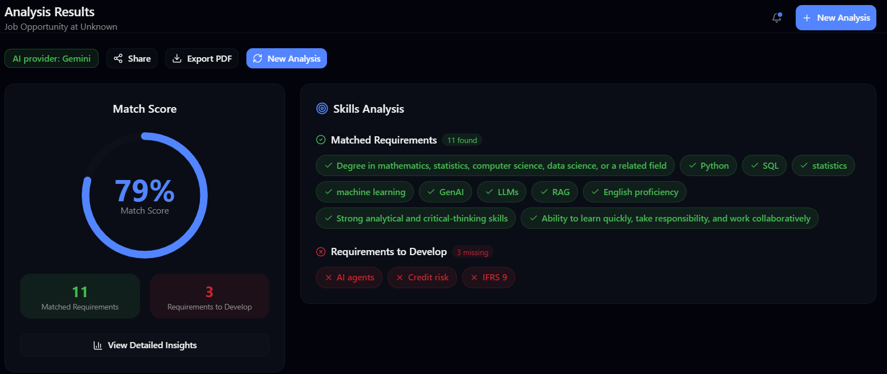
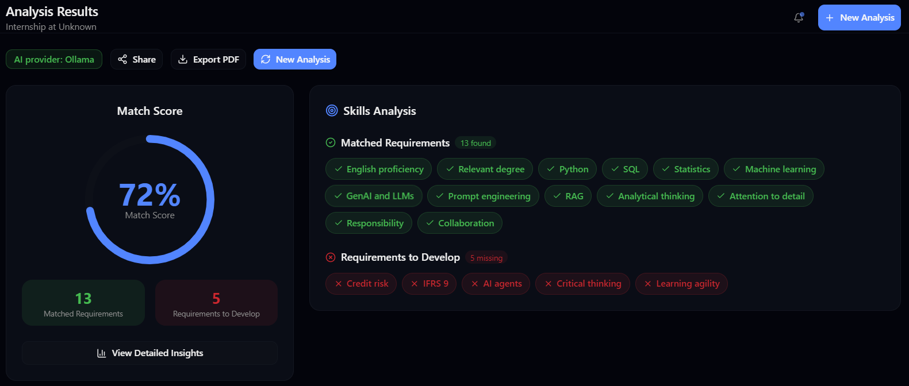
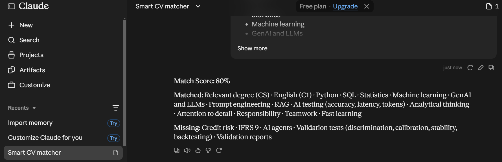

# OptiJob — Smart CV & Job Matcher

OptiJob is a full-stack application that compares a CV with a job description, explains matching and missing requirements with CV evidence, and helps users discover relevant vacancies.

## Features

- **Evidence-based CV analysis:** compare a PDF CV with a pasted job description and show supported matches and missing requirements.
- **Two integrated AI providers:** Google Gemini through the backend, or local Ollama.
- **Local RAG workflow:** index CV sections in PostgreSQL with pgvector, retrieve relevant excerpts, and use them as evidence for local analysis.
- **Requirement and keyword comparison:** surface relevant skills, terminology, and gaps.
- **Profile and history:** save a master CV, review previous analyses, and manage a user profile.
- **Job recommendations:** collect job listings and match them to a user's profile.

## AI Providers and Deployment Notes

| Provider | Where it runs | What is required |
| --- | --- | --- |
| Gemini | Google Gemini API, called by the backend | A reachable backend with GEMINI_API_KEY configured as a server-side secret |
| Ollama | Locally on the computer running the backend | Ollama plus the configured generation and embedding models |

The Ollama option is for a local setup; installing Ollama on one computer does not make it available to visitors of a public website. Do not put API keys in frontend code or commit them to Git. Configure secrets in the backend environment or hosting provider.

## AI Analysis Demo

The screenshots below show the same CV and internship description analyzed by the two providers integrated into OptiJob, followed by a separate manual comparison with Claude.

### Gemini — 79%

### Ollama — 72%

### Claude — 80% (external reference, not an OptiJob provider)

**How to read this comparison:** Gemini and Ollama are selectable in the application. Claude was asked separately for a comparison; it is not connected to the application. These percentages are examples from model outputs, not standardized benchmark scores, so results are not directly comparable. In these examples, Credit risk and IFRS 9 are shown as missing because the CV does not provide evidence for them.

The screenshots were captured from a local full-stack setup. A public frontend needs a deployed, reachable backend to run Gemini analyses online.

### Quality evaluation

The benchmark compares both providers on the same five human-labeled synthetic CV/job-description pairs (55 requirement decisions per provider). It reports requirement-level accuracy, precision, recall, F1, requirement coverage, exact-quote validity, and mean latency.

| Provider | Accuracy | Precision | Recall | F1 | Requirement coverage | CV quote validity | Mean latency |
| --- | ---: | ---: | ---: | ---: | ---: | ---: | ---: |
| Gemini | 87.3% | 82.1% | 100% | 90.1% | 100% | 100% | 2.40 s |
| Ollama (`qwen3:4b`) | 72.5% | 75.5% | 75% | 79.8% | 92.7% | 100% | 22.16 s |

These results are a preliminary synthetic benchmark, not a general accuracy claim for real CVs. Both providers used the same five cases, but the small sample is not sufficient to estimate performance across real candidates and vacancies. See [the benchmark instructions and limitations](docs/evaluation/README.md) to reproduce it.

## Architecture

- **Frontend:** React and TypeScript application built with Vite.
- **Backend API:** Express and TypeScript handles authentication, analysis records, profiles, and job APIs.
- **AI service:** Python FastAPI service handles Gemini analysis and vector retrieval for the RAG workflow.
- **Database:** PostgreSQL with pgvector stores application data and CV embeddings.
- **Local inference:** Ollama runs on the host machine; the AI service container reaches the host Ollama endpoint for embeddings.

~~~text
backend/
├── ai-service/       Python FastAPI service
├── prisma/           Prisma schema and database setup
└── src/
    ├── controllers/  API request handlers
    ├── middleware/   Authentication and request middleware
    ├── routes/       API routes
    └── services/     Analysis, retrieval, and application logic

frontend/
├── src/
│   ├── components/   Reusable UI components
│   ├── pages/        Application pages
│   ├── services/     Backend API clients
│   └── contexts/     Authentication and application state
└── public/           Static assets
~~~

## Technology Stack

- **Frontend:** React 19, TypeScript, Vite, Tailwind CSS, Radix UI, React Router
- **Backend:** Node.js, Express 5, TypeScript
- **AI:** Google Gemini API, Ollama, FastAPI, Pydantic
- **Data and retrieval:** PostgreSQL, Prisma, pgvector, embeddings, vector search
- **Other:** PDF parsing, JWT authentication, job scraping, scheduled tasks

## Run Locally

### Prerequisites

- Node.js 18 or newer and npm
- Docker Desktop with the WSL 2 engine
- Ollama, if you want to use Local AI (Ollama)

### 1. Configure environment variables

From the project root, copy the template and edit the local values:

~~~powershell
Copy-Item backend/.env.example backend/.env
~~~

Set strong local values for JWT secrets. Add a Gemini API key only if you plan to use Gemini. Keep backend/.env private; it must not be committed.

### 2. Start PostgreSQL

Start only the database first:

~~~powershell
docker compose --env-file backend/.env up -d db
~~~

### 3. Install backend dependencies and prepare a fresh database

Run these commands before starting the AI service on a fresh local database. The AI service creates the separate resume_chunks vector table when it starts.

~~~powershell
Set-Location backend
npm ci
npx prisma db push
npx prisma generate
npm run dev
~~~

The Express API runs at http://localhost:5000.

> Do not run Prisma db push against an existing database containing RAG data without checking its proposed changes. The current Prisma migration history was originally created for SQLite, while the active schema uses PostgreSQL; applying that old migration history to PostgreSQL is not supported.

### 4. Start the AI service

In a new terminal at the project root:

~~~powershell
docker compose --env-file backend/.env up -d ai-service
~~~

The FastAPI service is available at http://localhost:8000. PostgreSQL is exposed at localhost:5432.

### 5. Install Ollama models (optional)

To use Local AI (Ollama), install and start Ollama, then download the configured models:

~~~powershell
ollama pull qwen3:4b
ollama pull bge-m3
~~~

Keep Ollama running while using the local provider. Gemini does not require Ollama.

### 6. Start the frontend

In another terminal:

~~~powershell
Set-Location frontend
npm ci
npm run dev
~~~

Open http://localhost:5173, create an account, upload a PDF CV, paste a job description, and select Gemini or Local AI (Ollama).

## Environment and Secrets

The template is backend/.env.example. At minimum, configure database connection values and JWT secrets for local development. Configure GEMINI_API_KEY for Gemini. Other integrations, such as Google sign-in or email, require their corresponding server-side credentials.

Never commit backend/.env, API keys, passwords, or production secrets. For deployment, set secrets in the backend hosting provider's environment-variable settings.

## Build

~~~powershell
Set-Location backend
npm run build

Set-Location ../frontend
npm run build
~~~

## Project Team

- Shukurov Elshan
- Valiyev Farid
- Mansurov Akshin
- Aliyev Anar

Supervisor: Javid Guliyev

## Future Work

- Add and validate more job sources.
- Improve CV parsing and multilingual matching.
- Expand job alerts and profile insights.
- Explore a mobile experience.

## License

This project is private and confidential.

