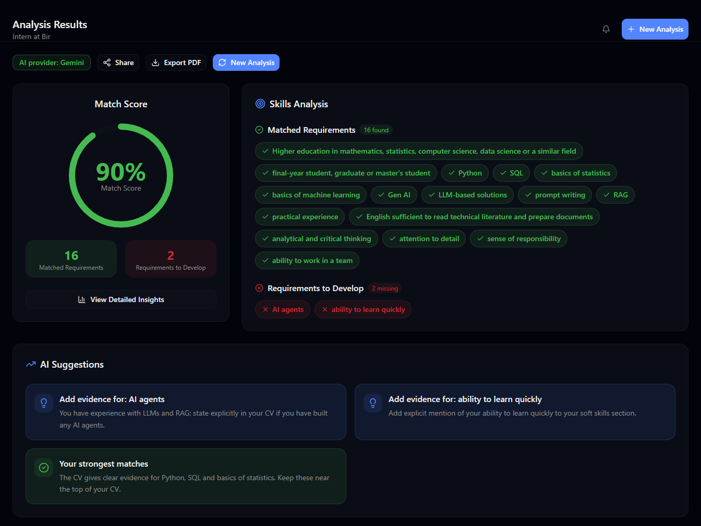
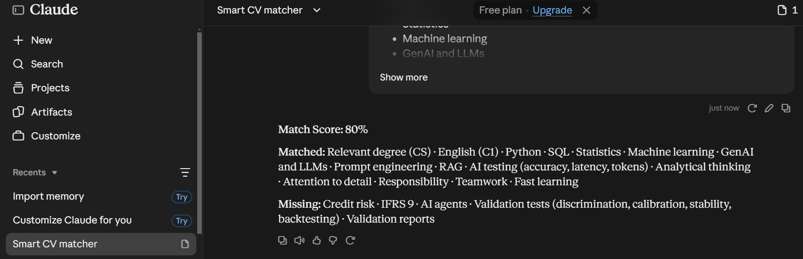
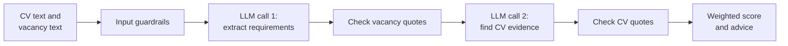
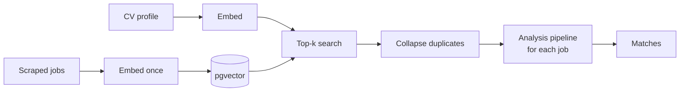

# OptiJob — Smart CV & Job Matcher

OptiJob compares a CV with a job description, shows which requirements the CV proves and which it does not, and recommends vacancies that fit the user's profile. Every match is backed by a quote from the CV, and the quote is checked by code before it is shown.

## Features

- **Evidence-based CV analysis:** upload a PDF CV, paste a job description, and get a checklist of requirements with a quote from the CV for each match.
- **Weighted match score:** required items count fully, nice-to-have items and soft skills count half.
- **Specific advice:** for each gap, one sentence on what to add to the CV.
- **Job recommendations (RAG):** scraped vacancies are embedded into a vector index, the closest ones to the user's profile are retrieved, and only those are analyzed in detail.
- **Three languages:** CVs and vacancies in English, Azerbaijani and Russian, including a CV and a vacancy in different languages.
- **Profile and history:** save a master CV, review previous analyses, manage a user profile.

## AI analysis demo

A real CV analyzed against a real internship vacancy (AI model validation intern). The vacancy text is in the repository in [English](backend/ai-service/evaluation/demo/vacancy.en.txt) and in the original [Azerbaijani](backend/ai-service/evaluation/demo/vacancy.az.txt).

The CV shows evidence for 16 of 18 requirements. "AI agents" and "ability to learn quickly" are reported as missing because the CV does not mention them.

For comparison, the same CV and vacancy were given to Claude by hand. Claude is not part of OptiJob, and it used its own list of requirements, so the two percentages are not directly comparable.

## How the AI part works

All model calls go through one Python service ([backend/ai-service](backend/ai-service)) that uses the Google Gemini API.

### Analysis pipeline

1. **Input guardrails.** Hidden characters are removed, e-mail addresses and phone numbers are replaced with placeholders, and lines that look like instructions to an AI are flagged.
2. **Extract requirements.** The model lists the vacancy's requirements one by one, each with the exact vacancy phrase, whether it is required or nice-to-have, and a category.
3. **Check vacancy quotes.** A requirement is kept only if its quote really is in the vacancy.
4. **Find CV evidence.** For each requirement the model returns a quote from the CV and a verdict, or advice if the requirement is not covered.
5. **Check CV quotes.** A "matched" verdict stands only if the quote is found word for word in the CV. Otherwise the requirement is reported as missing.
6. **Score.** The score is arithmetic over the verified results, not a number the model writes.

The model proposes; code decides. A match cannot appear in the result unless its quote exists in the CV.

Both calls use structured output (a JSON schema enforced by the API and validated again with Pydantic). The prompts are in [prompts.py](backend/ai-service/app/prompts.py) and each has a version that is logged with every call.

### Job recommendations (retrieval-augmented)

Before this design the application made one LLM call for every user and every new job. Now it makes one vector search per user and at most 10 LLM analyses.

Listings that have no description cannot be analyzed, so they are recommended by title similarity only and are labelled as such. The job boards the scraper reads return titles without descriptions in their list pages, so this is currently the common case; see [Future work](#future-work).

## Model and sampling settings

| Setting | Value | Why |
| --- | --- | --- |
| Generation model | `gemini-3.5-flash-lite` | Scored 97.8% on the evidence check below at about 2 to 3 seconds per call |
| Fallback model | `gemini-3.1-flash-lite` | Used for the last retry when the main model is overloaded or out of quota; it has its own quota and was reachable when larger models were not |
| Embedding model | `gemini-embedding-2`, 768 dimensions | Multilingual; one model for jobs and CVs so vectors are comparable |
| Temperature | `0` | The task is extraction and classification; see the experiment below |
| top-p, top-k (sampling) | provider default | They have nothing to choose between at temperature 0 |
| Retrieval top-k | `10` | On the retrieval test set all relevant jobs are within the top 10 |
| Duplicate threshold | `0.97` cosine | Two results this close to each other are treated as one vacancy |

All of these are environment variables (see [backend/.env.example](backend/.env.example)). Model names are pinned to exact versions, not `-latest` aliases, so a provider update cannot silently change results.

**Two different "top-k"s.** Sampling top-k limits the model to the k most likely next tokens when it writes. Retrieval top-k is how many documents the vector search returns. They are unrelated settings that share a name.

### Temperature and top-k experiment

The evidence check was run on 12 cases (107 decisions), three times per setting.

| Setting | Accuracy (mean of 3 runs) | Range | Same verdict in all 3 runs |
| --- | ---: | ---: | ---: |
| temperature 0 | 97.5% | 97.2% to 98.1% | 97.2% |
| temperature 1 | 96.9% | 96.3% to 97.2% | 99.1% |
| temperature 1, top-k 1 | 97.5% | 97.2% to 98.1% | 99.1% |
| temperature 2 | 97.5% | 97.2% to 98.1% | 99.1% |

What this shows:

- On this task the settings make almost no difference. All four are within one or two decisions of each other out of 107, which is inside the noise of a sample this size.
- Temperature 0 is not fully deterministic with this API: about 3 verdicts in 107 changed between identical runs. Repeatability has to be measured, not assumed.
- Top-k 1 at temperature 1 gave the same accuracy as temperature 0, as expected: both always take the most likely token.

Temperature 0 stays the default because the task has one right answer and nothing is gained from variety. The structured output schema and the quote check, not the sampling settings, are what keep the output stable.

## Duplicates in the vector index

The same vacancy often appears on several job boards. Without handling, copies of one job fill the search results. Three mechanisms prevent this:

| Level | Mechanism | Effect |
| --- | --- | --- |
| Storage | The job id is the primary key; indexing is an upsert | Re-indexing a job updates its row instead of adding a second vector |
| Embedding | A hash of the job text, model and dimensions is stored | Unchanged jobs are not embedded again (second indexing run: 0 embedded, 31 unchanged) |
| Search | Results with the same title and company, or with cosine similarity of 0.97 or more to an already chosen result, are merged into it | A re-posted vacancy takes one result slot, and its copies are listed under it |

The search fetches four times top-k candidates before merging, so removing duplicates still leaves top-k distinct jobs. On the retrieval test set, duplicate results in the top 5 went from 4 to 0 with full job text and from 9 to 0 with titles only.

The search itself is an exact nearest-neighbour scan. With thousands of jobs an exact scan takes milliseconds, and unlike an approximate index it cannot miss results when the search is filtered to a subset of jobs.

## Evaluation

The pipeline is tested on a labelled dataset: 26 CV and vacancy pairs with 185 requirement labels, covering technical and non-technical roles, three languages, level mismatches, negations and prompt-injection attempts. Prompts were tuned on 8 of the cases; the other 18 are a held-out test set. Details and commands are in [docs/evaluation](docs/evaluation/README.md).

Model: `gemini-3.5-flash-lite`, temperature 0.

### Evidence check

The model is given the correct requirement list and must decide matched or missing for each.

| Cases | Decisions | Accuracy | Precision | Recall | F1 |
| --- | ---: | ---: | ---: | ---: | ---: |
| All 26 | 185 | 97.8% | 97.8% | 99.2% | 98.5% |
| Held-out test (18) | 110 | 98.2% | 98.8% | 98.8% | 98.8% |
| Tuning set (8) | 75 | 97.3% | 96.2% | 100% | 98.1% |

Of the 134 matches the model claimed, all 134 quotes were found word for word in the CV. The four errors: "critical thinking" accepted on the strength of "analytical thinking" (twice), Prometheus accepted on the strength of Grafana, and one experience requirement (2+ years) rejected although the dates covered it.

| Slice | Decisions | Accuracy |
| --- | ---: | ---: |
| Real CV and vacancy | 34 | 94.1% |
| CV and vacancy in different languages | 29 | 96.6% |
| Russian | 14 | 100% |
| Azerbaijani | 30 | 96.7% |
| Level requirements (years, degree, language level) | 19 | 100% |
| Wishes and negations ("want to learn", "no experience") | 6 | 100% |
| Prompt injection | 11 | 100% |

### Requirement extraction

| Metric | Result |
| --- | ---: |
| Labelled requirements found in the model's list | 183 of 185 (98.9%) |
| Agreement on required or nice-to-have | 100% |
| Vacancy quotes that are word for word | 99.5% |
| Vacancy with no requirements handled (empty list, no second call) | 1 of 1 |

### End to end

The model checks the requirement list it extracted itself, as in production.

| Metric | Result |
| --- | ---: |
| Requirement-level accuracy | 97.3% |
| Precision / recall / F1 | 97.7% / 98.5% / 98.1% |
| Mean absolute error of the 0-100 score | 2.6 points |

### Job search

31 job postings in three languages (3 of them re-posted duplicates) and 12 candidate profiles.

| Job text indexed | Recall@3 | Recall@5 | Recall@10 | MRR | Duplicates in top 5 (before → after) |
| --- | ---: | ---: | ---: | ---: | ---: |
| Title and description | 91.7% | 100% | 100% | 1.00 | 4 → 0 |
| Title only | 87.5% | 95.8% | 100% | 1.00 | 9 → 0 |

### Speed and tokens

Measured with `gemini-3.5-flash-lite` on calls that needed no retry.

| Step | Time | Input tokens | Output tokens |
| --- | ---: | ---: | ---: |
| Extract requirements | about 2.3 s | about 850 | about 300 |
| Check evidence | about 2.3 s | about 1,100 | about 400 |
| Full analysis of the demo above (long vacancy, 18 requirements) | 5.9 s | 3,571 | 1,790 |
| Same analysis repeated (cache hit) | 0.01 s | 0 | 0 |
| Job search (embed the query and scan the index) | 0.4 s | | |

Token counts are averages over the golden dataset, where the texts are shorter than a real CV. Under rate limiting or provider load a call can take much longer: the slowest call in the full evaluation run took 32 seconds including retries.

A larger model was not compared: `gemini-3.8-flash` timed out on this API key during testing and `gemini-3.6-flash` ran out of quota after 7 cases, so there are no complete results for either.

### What these numbers do not show

- The dataset is small and mostly synthetic, with one real CV. It is not enough to claim accuracy on real CVs in general.
- The cases and labels were drafted with an AI assistant following written rules, and still need a human review.
- 31 jobs is an easy search problem; real indexes are far larger.
- The match score shown to users is not model accuracy.

## Guardrails and privacy

| Risk | What the service does |
| --- | --- |
| Hallucinated skills | Every match needs a quote that exists in the CV; unverified matches become "missing" |
| Invented requirements | Every requirement needs a quote that exists in the vacancy |
| Prompt injection in a CV or a scraped vacancy | Documents are passed as delimited data and cannot close their delimiter; instruction-like lines are flagged and can never be used as evidence; output is limited to a fixed schema |
| Contact details | E-mail addresses and phone numbers are removed before text is sent to the model or stored as the profile text |
| Invented links | Suggestions never contain URLs |
| Leaking data in logs | Logs and metrics tables hold counts and ids only, never CV or vacancy text |
| Provider failures | Timeouts, retries with backoff, a fallback model, a rate limiter, and clear error codes for quota and outages |

## Monitoring, cost and caching

- Every model call is stored in `llm_calls`: stage, model version, prompt version, tokens, latency, retries, cache hit, error kind.
- Every analysis is stored in `pipeline_runs` with quality signals: quotes that failed verification, requirements dropped, injection flags.
- `GET /metrics/summary` returns volume, error rate, cache hit rate, latency percentiles, token totals and the share of unverified quotes, which works as a hallucination rate in production. Cost is included when token prices are configured.
- Responses are cached by a hash of the model, sampling settings, prompt version and prompt text. A vacancy's requirement list is extracted once and reused for every user. Repeating an identical analysis takes about 10 ms and makes no model call.

## Architecture

- **Frontend:** React and TypeScript application built with Vite.
- **Backend API:** Express and TypeScript: authentication, analysis records, profiles, job scraping, scheduled matching.
- **AI service:** Python FastAPI: analysis pipeline, profile extraction, job index and search, metrics.
- **Database:** PostgreSQL with pgvector: application data, job embeddings, response cache, call logs.

~~~text
backend/
├── ai-service/
│   ├── app/
│   │   ├── main.py            HTTP API
│   │   ├── pipeline.py        analysis pipeline and scoring
│   │   ├── prompts.py         versioned prompts and response schemas
│   │   ├── guardrails.py      input cleaning, quote verification
│   │   ├── gemini_client.py   retries, fallback, rate limit, usage records
│   │   ├── job_index.py       embeddings, vector search, duplicate handling
│   │   ├── cache.py           response cache
│   │   └── telemetry.py       call logs and metrics
│   ├── evaluation/            golden datasets, runner, saved results
│   └── tests/                 unit tests (no network)
├── prisma/                    Prisma schema
└── src/                       Express API (controllers, routes, services)

frontend/
└── src/                       React application
~~~

### AI service endpoints

| Endpoint | Purpose |
| --- | --- |
| `POST /analyze` | Compare CV text with a job description |
| `POST /profile` | Extract skills (EN/AZ/RU) and a summary from CV text |
| `POST /jobs/index` | Add or update job postings in the vector index |
| `POST /jobs/search` | Top-k jobs for a profile, duplicates collapsed |
| `GET /metrics/summary` | Usage and quality metrics |
| `GET /health` | Status and current model settings |

Interactive API documentation is at http://localhost:8000/docs when the service is running.

## Technology stack

- **Frontend:** React 19, TypeScript, Vite, Tailwind CSS, Radix UI, React Router
- **Backend:** Node.js, Express 5, TypeScript, Prisma
- **AI:** Google Gemini API (generation and embeddings), FastAPI, Pydantic
- **Data and retrieval:** PostgreSQL, pgvector
- **Other:** PDF parsing, JWT authentication, job scraping, scheduled tasks, pytest

## Run locally

### Prerequisites

- Node.js 18 or newer and npm
- Docker Desktop
- A Gemini API key

### 1. Configure environment variables

~~~powershell
Copy-Item backend/.env.example backend/.env
~~~

Set the JWT secrets and `GEMINI_API_KEY`. Keep `backend/.env` private; it must not be committed.

### 2. Start PostgreSQL

~~~powershell
docker compose --env-file backend/.env up -d db
~~~

### 3. Start the backend

~~~powershell
Set-Location backend
npm ci
npx prisma db push
npx prisma generate
npm run dev
~~~

The Express API runs at http://localhost:5000.

> Check the changes Prisma proposes before running `db push` against a database that already holds data. The migration history in the repository was created for SQLite and is not applied to PostgreSQL.

### 4. Start the AI service

In a new terminal at the project root:

~~~powershell
docker compose --env-file backend/.env up -d --build ai-service
~~~

The service runs at http://localhost:8000 and creates its own tables on start.

### 5. Start the frontend

~~~powershell
Set-Location frontend
npm ci
npm run dev
~~~

Open http://localhost:5173, create an account, upload a PDF CV and paste a job description.

## Tests

~~~powershell
Set-Location backend/ai-service
python -m venv .venv
.venv\Scripts\python -m pip install -r requirements.txt -r requirements-dev.txt
.venv\Scripts\python -m pytest
~~~

The unit tests use a fake model and need no API key. The evaluation commands are in [docs/evaluation](docs/evaluation/README.md).

## Environment and secrets

The template is [backend/.env.example](backend/.env.example). Never commit `backend/.env`, API keys, passwords or personal documents such as a CV. For deployment, set secrets in the hosting provider's environment settings. If the AI service is reachable from outside the backend host, set `AI_SERVICE_KEY` for both.

## Project team

- Shukurov Elshan
- Valiyev Farid
- Mansurov Akshin
- Aliyev Anar

Supervisor: Javid Guliyev

## Future work

- Fetch full job descriptions in the scraper, so recommended jobs get the full requirement analysis instead of title similarity.
- Grow the golden dataset with reviewed real CVs and vacancies.
- OCR for scanned PDFs.
- A user feedback signal (thumbs up or down) on each analysis.
- An assistant that uses job search and analysis as tools.

## License

This project is private and confidential.
